# TalentFlow · ATS con análisis de CV

Sistema de seguimiento de candidatos (Applicant Tracking System) construido con **Python (FastAPI) + PostgreSQL** y **React + Vite + TailwindCSS**. Analiza CVs en PDF/Word, calcula la compatibilidad candidato–vacante y gestiona todo el proceso de selección, cumpliendo con la protección de datos personales.

> Proyecto de portafolio · Anggie Alcedo


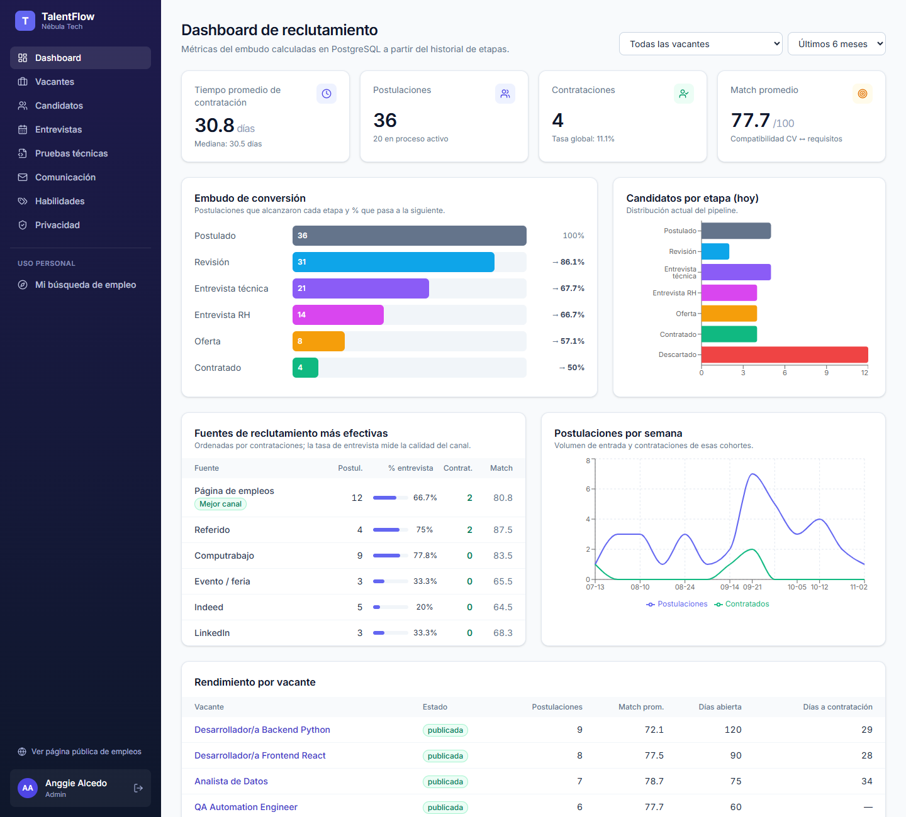

## Capturas

| Pipeline Kanban | Detalle del candidato (habilidades que coinciden) |
|---|---|
| 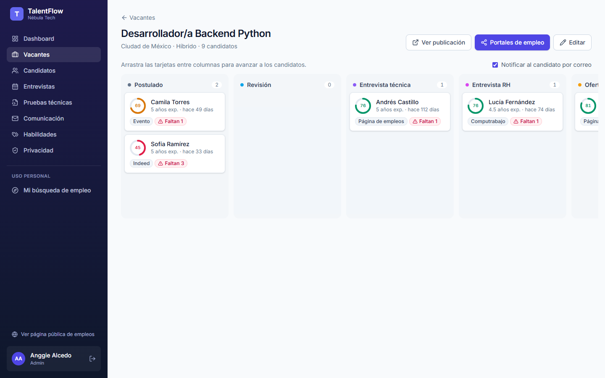 | 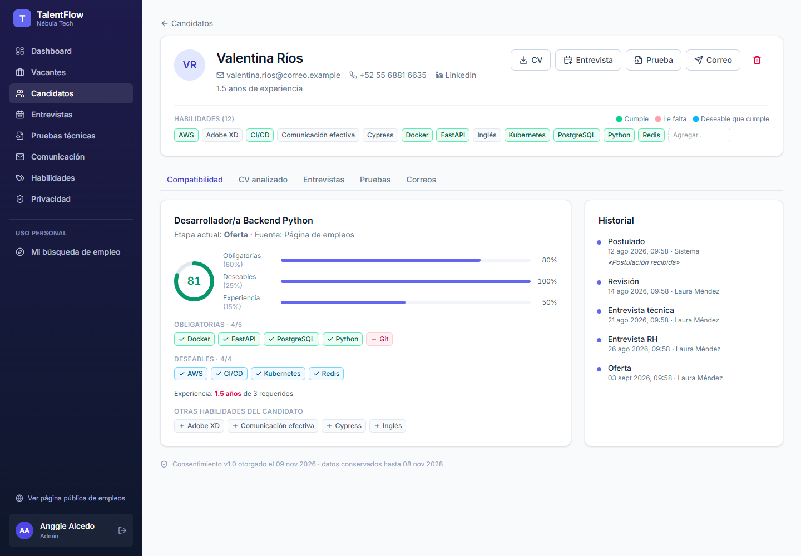 |
| **Búsqueda full-text en CVs** | **Agenda de entrevistas** |
| 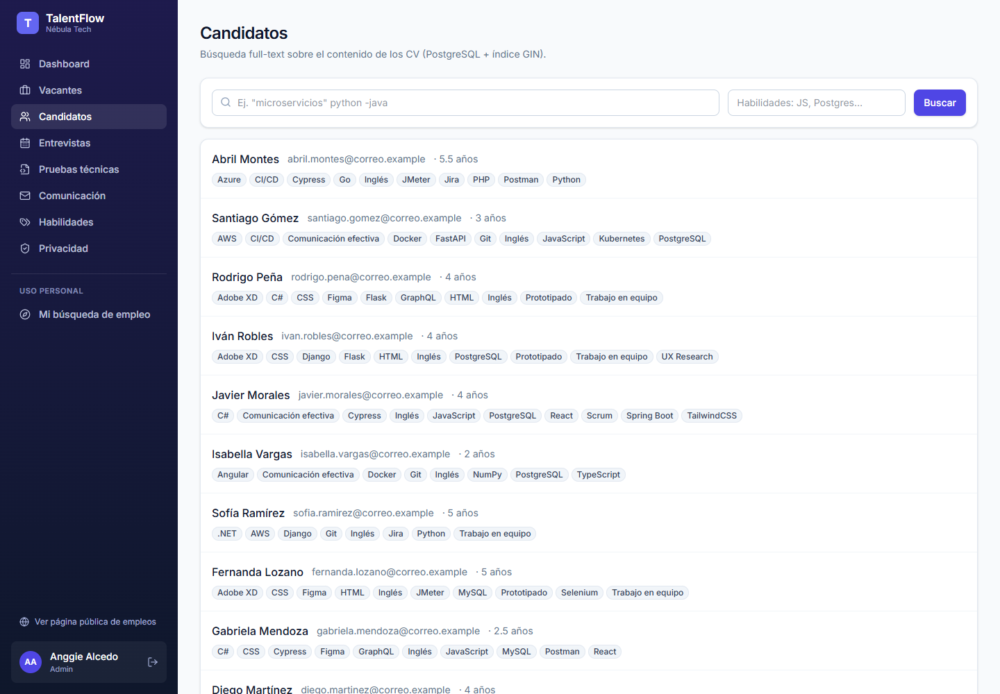 | 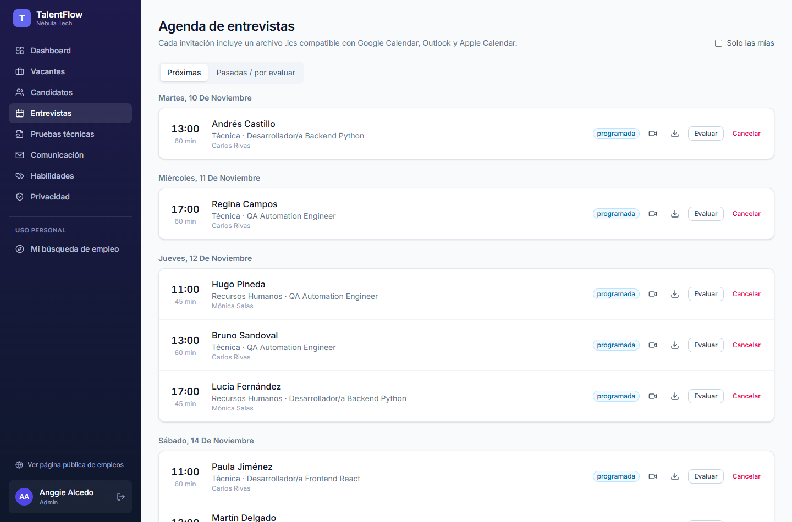 |
| **Pruebas técnicas** | **Plantillas de correo** |
| 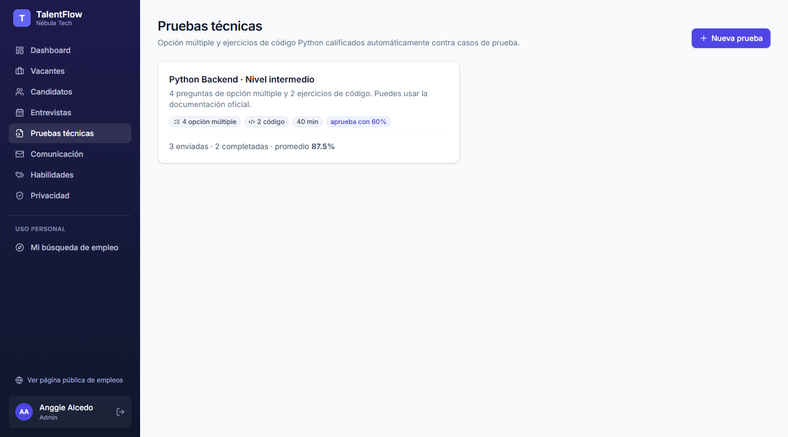 | 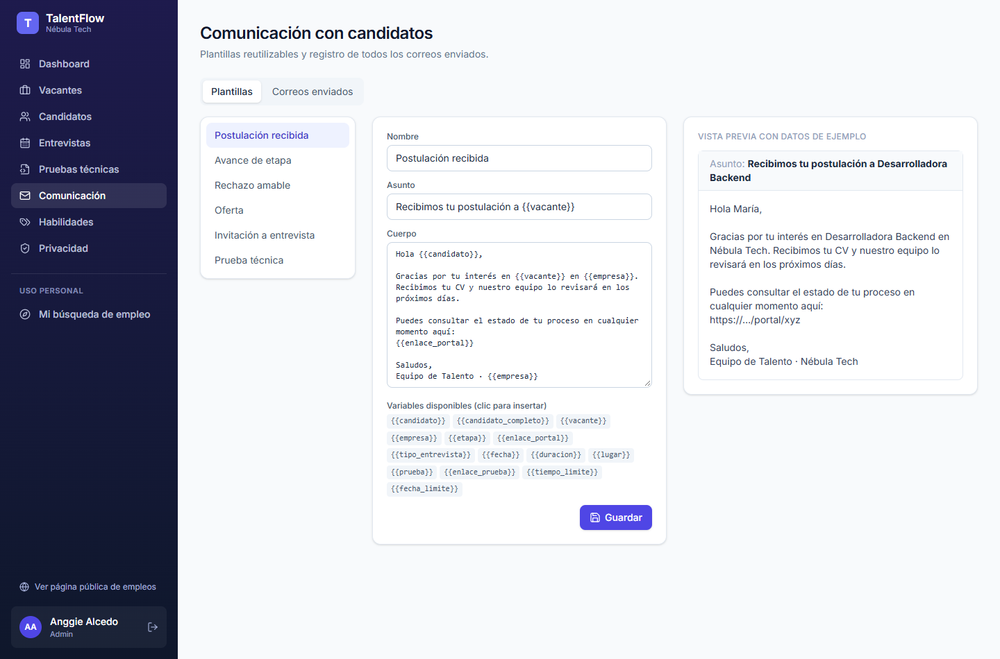 |
| **Habilidades con sinónimos** | **Privacidad y protección de datos** |
| 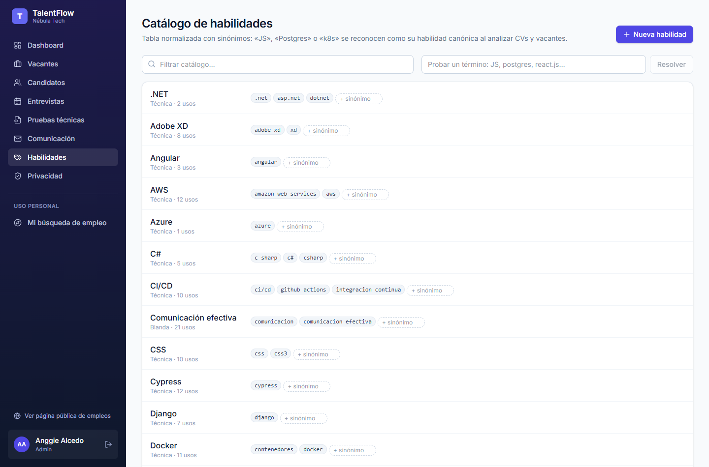 | 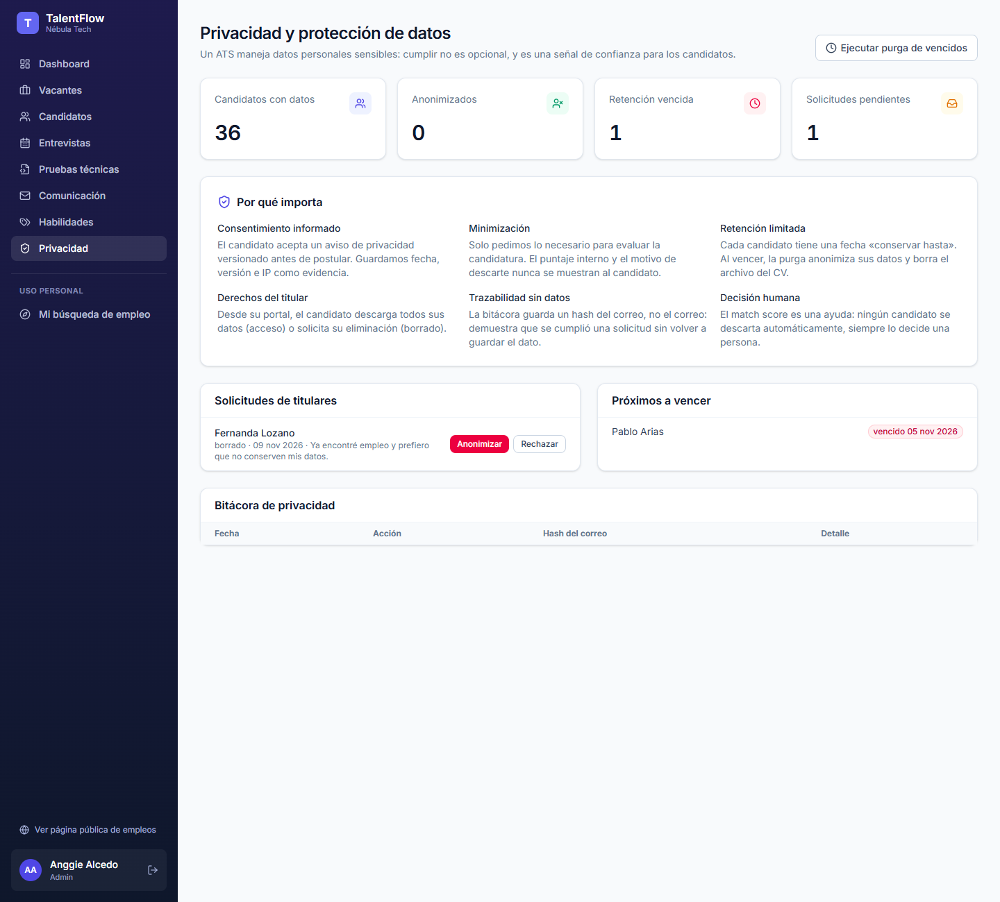 |
| **Modo uso personal: mi búsqueda de empleo** | **Página pública de empleos** |
| 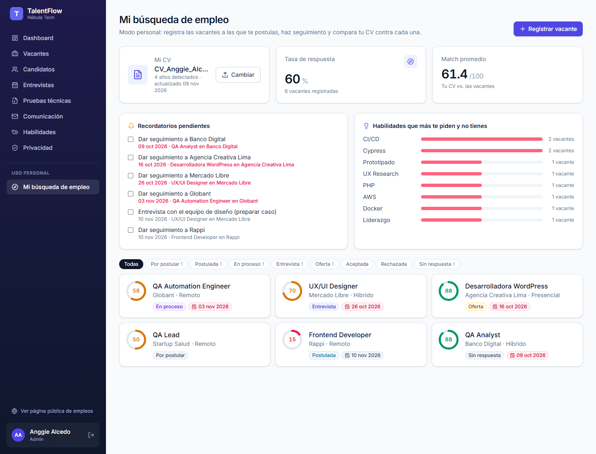 | 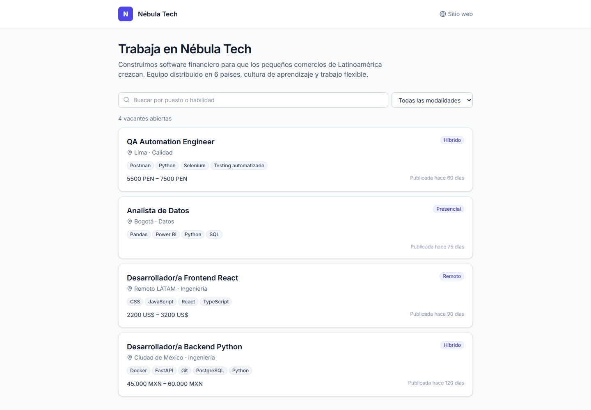 |
| **Postulación con CV** | **Portal del candidato** |
| 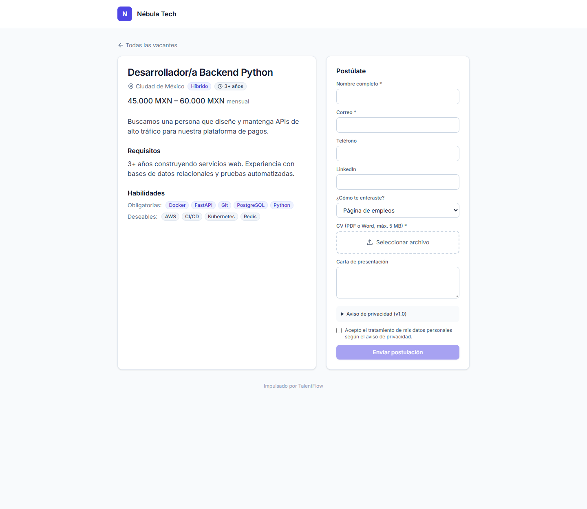 | 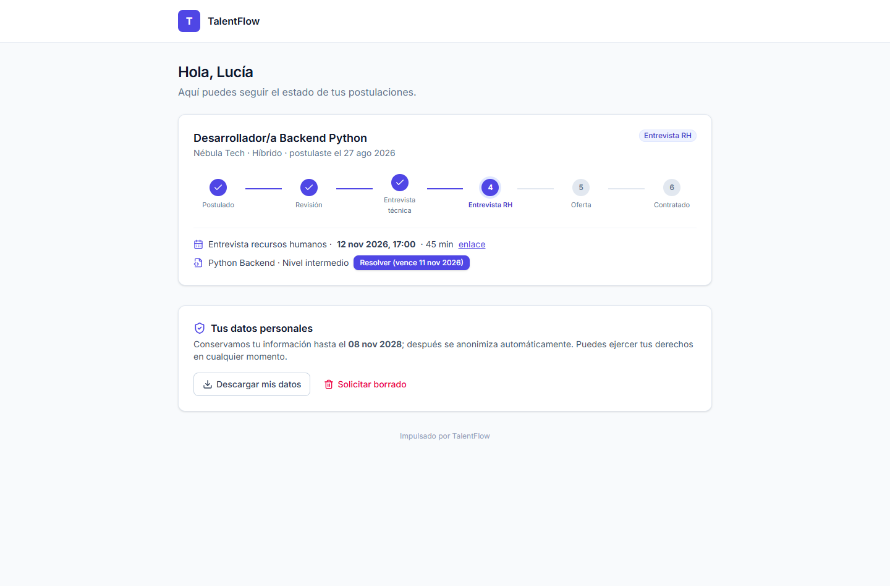 |

## Funcionalidades

| Módulo | Qué hace |
|---|---|
| **Vacantes** | Requisitos, habilidades obligatorias/deseables, salario, modalidad (remoto/híbrido/presencial) y **página pública de empleos** por empresa. |
| **Postulación** | Formulario público con carga de CV (PDF o DOCX, máx. 5 MB) y consentimiento informado. |
| **Análisis de CV** | `pdfplumber` + `python-docx` extraen el texto; reglas + **spaCy `es_core_news_sm`** detectan nombre, contacto, experiencia (años calculados por rangos de fechas), educación, idiomas, organizaciones y habilidades. |
| **Match score** | 60 % obligatorias · 25 % deseables · 15 % experiencia (pesos redistribuidos si la vacante no define algún grupo). Muestra qué requisitos cumple y cuáles faltan. |
| **Portales de empleo** | Computrabajo, LinkedIn, Indeed, Bumeran, OCC, elempleo y Glassdoor. Cada vacante genera un **enlace con `?fuente=`** para pegar en el aviso del portal, y permite **importar en lote** (hasta 50) los CV descargados del panel del portal: se extraen nombre y correo, se calcula el match y el candidato entra en «Postulado». Estos portales no ofrecen una API pública de postulantes y extraer datos con un robot viola sus términos de uso, así que estas son las vías legítimas. |
| **Pipeline Kanban** | Postulado → Revisión → Entrevista técnica → Entrevista RH → Oferta → Contratado / Descartado, con arrastrar y soltar e historial auditable. |
| **Entrevistas** | Agenda con invitaciones por correo y archivo **.ics** (UID + SEQUENCE, así reprogramar o cancelar actualiza el evento del calendario). |
| **Evaluaciones** | Retroalimentación por entrevistador con calificación de 1 a 5 por competencia y recomendación. |
| **Pruebas técnicas** | Enlace único con preguntas de opción múltiple y de **código Python**, calificadas automáticamente contra casos de prueba en un subproceso aislado con tiempo límite. |
| **Comunicación** | Plantillas editables (recibido, avance de etapa, rechazo amable, oferta…) con variables `{{candidato}}` y vista previa. |
| **Portal del candidato** | Enlace con token para ver en qué etapa va, sus entrevistas y pruebas, descargar sus datos o pedir que se borren. |
| **Dashboard** | Tiempo promedio y mediana de contratación, candidatos por etapa, embudo de conversión y fuentes de reclutamiento más efectivas. |
| **Modo uso personal** ⭐ | Mi propio registro de vacantes a las que me postulo: estado, fechas de seguimiento y recordatorios, y análisis de **mi CV contra cada oferta** con sugerencias de qué reforzar. |

## Base de datos (PostgreSQL)

- Tablas: `vacantes`, `candidatos`, `postulaciones`, `etapas`, `historial_etapas`, `entrevistas`, `evaluaciones`, `documentos`, `pruebas`, `correos`, `solicitudes_privacidad`, `bitacora_privacidad`, etc. (`backend/sql/01_schema.sql`).
- **Búsqueda full-text**: `documentos.tsv` es una columna `tsvector` *generada* con una configuración propia `tf_es` (español + `unaccent`), indexada con **GIN**. Se consulta con `websearch_to_tsquery` (admite `"frase exacta"`, `-excluir`) y `ts_headline` resalta el fragmento que coincide.
- **Habilidades normalizadas**: `habilidades` + `habilidad_sinonimos` (`JS` → JavaScript, `Postgres` → PostgreSQL, `k8s` → Kubernetes). La misma resolución se usa al leer CVs, al crear vacantes y en los filtros.
- Las métricas del dashboard se calculan en SQL (CTEs y `percentile_cont`) sobre el historial de etapas.

## Protección de datos personales

Un ATS guarda CVs, teléfonos, direcciones e historial laboral: información personal que, si se filtra o se usa mal, daña a personas reales. Además, leyes como el GDPR, la LFPDPPP (México) o la Ley 1581 (Colombia) obligan a tratarla con una finalidad clara y por un tiempo limitado. Por eso TalentFlow incluye:

1. **Consentimiento informado y versionado**: no se acepta una postulación sin él; se guarda fecha, versión del aviso e IP.
2. **Retención limitada**: cada candidato tiene una fecha «conservar hasta» (24 meses por defecto). Una purga anonimiza a los vencidos y elimina el archivo del CV.
3. **Derecho de acceso y de borrado** desde el portal del candidato; el administrador atiende las solicitudes.
4. **Anonimización en lugar de borrado en cascada**: las métricas agregadas se conservan sin datos personales.
5. **Bitácora con hash del correo**: demuestra que se atendió una solicitud sin volver a guardar el dato.
6. **Minimización**: el candidato no ve su puntaje interno ni el motivo de descarte, y ningún candidato se descarta automáticamente: siempre lo decide una persona.

## Cómo ejecutarlo (Windows, sin Docker)

Requisitos: Python 3.12+, Node 20+, PostgreSQL 14+.

```powershell
# 1. Base de datos (como superusuario postgres)
psql -U postgres -h localhost -f backend/scripts/crear_bd.sql

# 2. Backend
cd backend
python -m venv venv
venv\Scripts\pip install -r requirements.txt
venv\Scripts\python -m spacy download es_core_news_sm
copy .env.example .env
venv\Scripts\python -m scripts.init_db     # crea el esquema
venv\Scripts\python -m scripts.seed        # datos de demostración (borra los anteriores)
venv\Scripts\uvicorn app.main:app --port 8075

# 3. Frontend (otra terminal)
cd frontend
npm install
npm run dev                                # http://localhost:5176
```

Documentación interactiva de la API: <http://localhost:8075/docs>

### Usuarios de demostración (contraseña `Demo1234!`)

| Correo | Rol |
|---|---|
| admin@talentflow.demo | Administradora |
| reclutadora@talentflow.demo | Reclutadora |
| carlos@talentflow.demo | Entrevistador |

Página pública de empleos: <http://localhost:5176/empleos/nebula-tech>

Sin un servidor SMTP configurado, los correos se guardan como «simulado» y pueden leerse completos en **Comunicación → Correos enviados**.

### Pruebas

```powershell
cd backend
venv\Scripts\python -m pytest -q
```

Las pruebas de integración usan la base de demostración; después de ejecutarlas, `python -m scripts.seed` la deja limpia.

## Estructura

```
backend/
  app/
    routers/      endpoints por módulo (vacantes, candidatos, entrevistas, pruebas, público, personal…)
    services/     cv_parser, matching, habilidades, calificador, ics, correo, privacidad
    models/       SQLAlchemy 2
  sql/            esquema, índices GIN y vistas
  scripts/        crear_bd.sql, init_db, seed
  tests/
frontend/
  src/pages/      panel interno + pages/publico (empleos, postulación, portal, prueba)
  src/components/ ui.jsx (sistema visual) y acciones.jsx (match, CV resaltado, modales)
```
